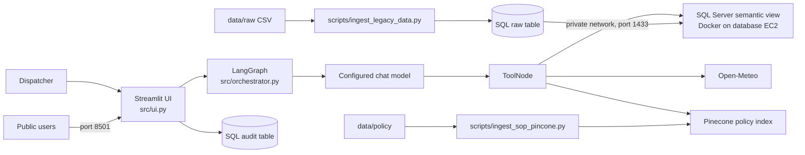

# Cold-Chain Logistics Assistant

A conversational dispatch assistant for combining fleet telemetry, current weather, and cold-chain operating procedures. The project targets the manual effort involved in checking a database, external conditions, and policy documents during a logistics incident. A Streamlit interface sends questions to a LangGraph agent with tools for SQL Server, Open-Meteo, and Pinecone retrieval.

The documented deployment uses two separate EC2 instances: one hosts Microsoft SQL Server inside Docker, and a second runs the Streamlit application and is reachable by public users on port 8501. The intended network boundary keeps SQL Server's port 1433 private and allows database traffic from the application host. This is a decision-support prototype; it does not train a predictive model, dispatch vehicles, or perform route optimization.

## Project overview

The repository demonstrates how natural-language requests can be connected to existing operational data and policy sources. The agent can query a curated SQL view, request current weather for coordinates, and retrieve relevant SOP passages. The LangGraph loop passes tool results back to a configured chat model for synthesis.

The included Kaggle CSV is used by a separate ingestion script to populate a SQL Server raw table; the running application does not read the CSV directly. Policy files are separately indexed into Pinecone. These setup steps and the external SQL Server, Pinecone index, model provider, credentials, and ODBC driver are prerequisites for an end-to-end run.

## Features

- **Natural-language dispatch interface:** Streamlit chat UI that displays assistant responses and expandable tool inputs and outputs.
- **Telemetry lookup:** SQL Server tool querying `FDE_VIEWS.VW_ACTIVE_FLEET`, which exposes selected and renamed fields from a legacy-style table.
- **Weather lookup:** Open-Meteo current weather request for supplied latitude and longitude; the tool derives a two-level corridor score from wind speed.
- **Policy retrieval:** Pinecone similarity search over policy documents ingested from `data/policy/`.
- **Audit viewer:** Separate UI mode for reading SQL audit records; the application attempts to write tool traces and responses to an audit table.
- **Data and policy ingestion scripts:** CSV-to-SQL mapping and incremental policy chunking/indexing are provided as manual workflows.

The audit trail is best-effort and depends on separately provisioned table permissions. The UI path currently does not inject the system prompt found in `src/prompts/system_prompt.txt`; the prompt is loaded by the command-line runner only. The query tool's `SELECT` prefix check is not a complete SQL safety boundary, so database permissions must enforce read-only, view-scoped access.

## Technology stack

| Role | Technology | Use |
|---|---|---|
| Language | Python 3.12.13 | Application and ingestion scripts |
| User interface | Streamlit | Chat and audit-log viewer |
| Agent orchestration | LangGraph and LangChain | Reasoner/tool loop, tool binding, and message state |
| Language models | OpenAI-compatible `ChatOpenAI` wrapper or Ollama | Configurable chat model; code includes OpenAI, DeepSeek-compatible, and local Ollama paths |
| Embeddings and retrieval | Hugging Face embeddings or OpenAI embeddings; Pinecone | Embed queries and retrieve policy chunks from a managed vector index |
| Data processing | pandas | Load CSV data into SQL and display audit records |
| Relational data | Microsoft SQL Server, SQLAlchemy, pyodbc | Store telemetry and audit records; query the semantic view |
| External API | Open-Meteo | Current weather lookup |
| Configuration | python-dotenv | Load local environment settings |
| Deployment | Two EC2 instances, Docker, systemd, GitHub Actions/SSH | SQL Server runs in Docker on the database instance; Streamlit runs on a separate publicly reachable app instance |

`requirements.txt` also declares packages that are not directly used by the application source. No automated test, lint, or formatting setup is present in the repository.

## Architecture and workflow



The CSV loader selects nine columns, renames them to legacy-style SQL fields, adds an ingestion flag, and replaces `dbo.TBL_SC_FLEET_HIST_RAW`. `scripts/setup_security_and_view.sql` creates a view over selected raw-table columns. The assistant's SQL tool reads that view, the weather tool calls Open-Meteo, and the SOP tool searches up to two matching Pinecone passages. The model may call tools in a loop and then synthesize their text results.

### Deployment topology

The deployment instructions describe two EC2 hosts with separate responsibilities:

| Host | Service | Network role |
|---|---|---|
| Database EC2 | Microsoft SQL Server 2022 in a Docker container, with port 1433 mapped on the host | Private data tier; the design document says SQL access should be limited to the application instance's private IP |
| Application EC2 | Streamlit served on `0.0.0.0:8501` under systemd | Public application tier; port 8501 is the user-facing entry point |

The intended request path is public user → Streamlit app host → SQL Server host over the private network. The helper instructions also use an SSH tunnel for developer access to SQL and explicitly advise against exposing port 1433 to the public internet. These files document the target topology; the current AWS security-group rules and live deployment state were not inspected. The workflow and manual deployment instructions have path and service-name inconsistencies, so reconcile them before using the deployment commands.

The CLI path in `src/orchestrator.py` reads the system prompt before accepting input. The Streamlit UI imports the compiled graph directly and currently supplies only the user message. Graph conversation state uses an in-memory LangGraph checkpointer and is not durable across process restarts.

## Dataset and provenance

`data/source/data.txt` identifies the Kaggle source as [Logistics and supply chain dataset](https://www.kaggle.com/datasets/datasetengineer/logistics-and-supply-chain-dataset) by `datasetengineer`. A CSV copy is present at `data/raw/dynamic_supply_chain_logistics_dataset.csv` (32,065 rows and 26 columns). The expected directory named `logistics-and-supply-chain-dataset` is not present.

The data includes timestamps, GPS coordinates, temperatures, risk and delay fields, congestion, inventory, costs, supplier, customs, driver, and other operational indicators. The loader currently selects only timestamp, coordinates, temperature, cargo-condition status, risk classification, delay probability, port congestion, and route risk. The file has no explicit shipment identifier or commodity type, and the repository does not include a data dictionary, dataset version, download date, or verified license. Those gaps limit interpretation and attribution; users should confirm Kaggle terms before redistributing the data.

## Repository structure

```text
data/
  policy/                         Cold-chain SOP source
  raw/                            Kaggle CSV consumed by SQL loader
  source/data.txt                 Dataset source URL
scripts/
  ingest_legacy_data.py           Load selected CSV columns into SQL Server
  setup_security_and_view.sql     Create semantic view and SQL permissions
  ingest_sop_pincone.py           Parse and index policy files in Pinecone
src/
  agent_tools.py                  SQL, weather, and policy-retrieval tools
  orchestrator.py                 LangGraph graph and CLI runner
  prompts/system_prompt.txt       Intended agent instructions
  ui.py                           Streamlit application
Misc/                             Project presentation, design, and run notes
helpers/                          SQL connection guidance
requirements.txt                  Python dependency pins
.env.example                      Configuration key template
PROJECT_SUMMARY.md                Detailed implementation analysis
```

## Installation and setup

The following commands create a Python environment; the complete application also requires externally provisioned services.

```bash
python3.12 -m venv .venv
source .venv/bin/activate
python -m pip install -r requirements.txt
cp .env.example .env
```

Edit `.env` with valid credentials and settings. At minimum, the current tools require a Pinecone API key, a selected embedding mode/model, SQL Server host and port, SQL credentials, and the configured model provider's credentials. The default embedding mode is local and uses `BAAI/bge-m3` when no model name is supplied; the Pinecone index must match that embedding dimension. `DEEPSEEK_API_KEY` is needed for the DeepSeek branch, while the OpenAI branch needs its provider key. Do not commit `.env`.

Additional prerequisites:

1. Provision a reachable Microsoft SQL Server instance and install the operating-system ODBC Driver 18 for SQL Server.
2. Ensure the Kaggle CSV is available at `data/raw/dynamic_supply_chain_logistics_dataset.csv`. It is already present in this repository checkout; if using a source download, verify Kaggle access and license terms first.
3. Create the raw table, semantic view, and account permissions using the documented database workflow. The SQL script creates the view and agent user, but audit table creation and its insert grant are described separately in `Misc/instrutions.md`.
4. Provision a Pinecone index for the selected embedding model and credentials.

The repository pins Python 3.12.13 in `.python-version`. Some imported packages are not explicitly listed as direct requirements, and a clean environment setup has not been verified. If imports fail, reconcile the missing dependency pins before running deployment workflows.

## Usage

Load the CSV into the configured SQL Server only when a full reload is intended; the script replaces the existing raw table:

```bash
python scripts/ingest_legacy_data.py
```

Index or update policy files in Pinecone:

```bash
python scripts/ingest_sop_pincone.py
```

Run the Streamlit app:

```bash
streamlit run src/ui.py
```

The app provides a dispatch chat and a security/audit-log mode. Successful operation depends on the external services and permissions described above. The ingestion scripts and app were not run as part of this documentation work, so these commands are entry points from source inspection rather than verified end-to-end results.

For a terminal-based interaction, run:

```bash
python src/orchestrator.py
```

## Acknowledgments and references

- Dataset source: [Logistics and supply chain dataset on Kaggle](https://www.kaggle.com/datasets/datasetengineer/logistics-and-supply-chain-dataset).
- Weather source: [Open-Meteo API](https://open-meteo.com/).
- Operational rules: `data/policy/Cold_Chain_Incident_SOP_v2.md`.